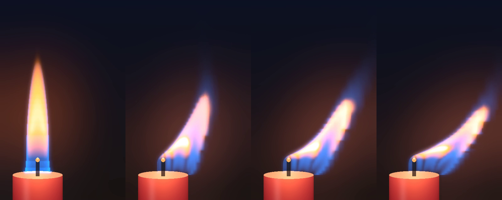

# OpenFOAM candle flame

A laminar candle flame simulated with **OpenFOAM v2412**, checked against **Cantera**, and rendered physically in **Blender Cycles**. The yellow glow comes from blackbody light at the simulated temperatures. The blue comes from CH\* and C₂\* chemiluminescence in the simulated reaction zone.

<p align="center">
  
  
</p>

▶ **Video:** [media/candle_physics.mp4](media/candle_physics.mp4) shows the candle, then breaks it down into soot glow, blue chemiluminescence, reaction zone, temperature and flow.

## What is simulated

| | |
|---|---|
| Solver | `rhoReactingBuoyantFoam`: laminar, compressible, buoyant, reacting |
| Geometry | 2D axisymmetric wedge: wick Ø 1.5 mm × 6 mm, candle Ø 20 mm, domain 40 mm × 120 mm, 14 k cells |
| Fuel | wax vapour modelled as n-dodecane, released from the wick at 0.1 g/min (a typical household candle) |
| Chemistry | Westbrook–Dryer 2-step (C₁₂H₂₆ → CO → CO₂), with the rate tuned against the detailed `nDodecane_Reitz` mechanism (100 species) in Cantera |
| Thermo / transport | NASA polynomials and Sutherland viscosity fits generated from Cantera species data |
| Radiation | P1 with grey-gas CO₂/H₂O absorption |
| Ignition | a 1500 K zone held around the wick tip for the first 40 ms |

**Results** (steady from about 0.3 s): flame tip 44 mm above the wax, peak gas temperature 1923 K, heat release about 73 W. The 2-step chemistry gives a stoichiometric flame speed of 0.78 m/s (detailed mechanism: 0.93 m/s; n-dodecane/air at 470 K).

## Honest caveats

- **No soot model.** The yellow luminous zone in the renders uses a *soot proxy*: hot, fuel-rich gas that contains CO. Without soot radiating heat away, the peak temperature (≈1920 K) is higher than in real candles (≈1670 K).
- **The wick is a fixed fuel-vapour source.** Wax melting, capillary rise and evaporation are not simulated.
- **2-step chemistry** captures flame shape and temperature well, but not intermediate species or soot precursors.
- **The flicker in the video is not simulated.** The axisymmetric flame is steady (real candles nearly are in still air). The Blender animation sways and stretches the steady flame to stand in for a gentle draft. The quasi-3D solver below *does* simulate the lean in a draft.
- **Flame height is on the tall side.** Roper's correlation for this fuel rate predicts about 28 mm; real candles are typically 30–50 mm.

## Run it

Linux or WSL2, with conda/mamba:

```bash
conda env create -f environment.yml
conda activate candle
NP=8 ./Allrun          # OpenFOAM run + plots + Blender renders + GIF/MP4
```

`Allrun` options: `NP` (cores, default 2), `END_TIME=0.05` (quick test), `SKIP_BLENDER=1`, `CANDLE_GPU=1` (Cycles on an NVIDIA GPU via OptiX/CUDA).

**Blender** needs either the `bpy` module on Python 3.13 (`python3.13 -m pip install bpy==5.2.2`, set `BPY_PYTHON` if it isn't `python3.13`), or the Blender 5.2 app (`BLENDER=/path/to/blender`).

On 2 CPU cores the 0.5 s OpenFOAM run takes about 25 min. A full-resolution Cycles still takes about 20 min on 2 CPU cores, and much less on a GPU.

<details>
<summary>Step by step</summary>

```bash
source etc/env.sh                         # OpenFOAM paths for the conda-forge build (+ fixes parallel Pstream)
python gen.py case                        # writes the case (mesh, thermo, chemistry, BCs)
cd case && cp -r 0.orig 0
blockMesh && topoSet && setFields
decomposePar && mpirun -np 8 rhoReactingBuoyantFoam -parallel && reconstructPar
postProcess -func writeCellCentres -time 0 && cd ..

python post.py case out                   # temperature / reaction-zone figure, ignition GIF, key numbers
python render.py case out                 # 2D line-of-sight render (no Blender)
python export_fields.py case fields       # emission maps for Blender
python gif_panels.py case gif             # physics breakdown panels
python3.13 blender_scene.py beauty 1080 1620 64 blend/candle_blender.png
python calib/calib.py det                 # detailed-mechanism flame speeds (Cantera)
python calib/calib.py 2s 9.6e11           # 2-step flame speeds with the tuned rate
```
</details>

## Files

| File | Purpose |
|---|---|
| `gen.py` | generates the complete OpenFOAM case from Cantera data |
| `calib/` | Cantera 1D flames: detailed mechanism vs 2-step calibration |
| `post.py`, `render.py` | result figures, ignition animation, 2D physical render |
| `export_fields.py`, `blender_scene.py` | emission maps → Blender volume (soot blackbody + chemiluminescence) |
| `gif_panels.py`, `make_gif.py` | physics panels and the GIF/MP4 |
| `etc/env.sh` | environment for conda-forge OpenFOAM |
| `data/radiationProperties.SandiaD_LTS` | grey-gas coefficients from the OpenFOAM tutorial |

## Quasi-3D candle in a draft (`quasi3d/`)

The axisymmetric flame above cannot lean. `quasi3d/` adds a **quasi-3D (2.5D) low-Mach reacting solver** written in
Python (NumPy/SciPy, Numba for the chemistry): fields are expanded in azimuthal Fourier modes,
f(r, z, θ) = Σ_m f_m(r, z) e^{imθ}, so a gentle side draft makes the flame lean *in the simulation*. The chemistry,
thermo and transport are identical to the OpenFOAM case (same `gen.py` coefficients).

<p align="center">
  
</p>

▶ **Video:** [quasi3d/figs/candle_draft_quasi3d.mp4](quasi3d/figs/candle_draft_quasi3d.mp4): the flame in a 0.2 m/s
draft, simulated with finite-rate chemistry (M = 4 modes, 0.2 s after the draft starts, slowed down ≈17×), rendered by
line-of-sight integration of a soot-proxy blackbody plus CH*/C₂* chemiluminescence.

**Method.**
- Cell-centred finite volumes in (r, z) with no node on the axis. Azimuthal modes are pseudo-spectral with
  dealiasing. Axis parity is enforced by ghost cells.
- Variable-density projection with a divergence constraint ∇·u = S. S comes from the non-advective scalar rates,
  and the Dodd–Ferrante splitting gives one constant-coefficient Poisson solve per mode (factorised once).
- Viscous terms: implicit vector Laplacian through u± = u_r ± i u_θ.
- Face mass fluxes use the equation-of-state density of the face state, so fuel mass is conserved.
- Scalars live at the collocation angles and are transported with a bounded finite-volume θ flux (`THETA_FV`).
- Finite-rate 2-step chemistry is integrated per point with a Rosenbrock method and Strang splitting.
- Radiation is optically thin with grey CO₂/H₂O.

**Validation** (details, numbers and history in [quasi3d/STATUS.md](quasi3d/STATUS.md)):

| stage | check | result |
|---|---|---|
| 1 cold crossflow | uniform m = 1 draft stays uniform (< 1 %) | 0.20 % (M = 4); exact discrete steady state |
| 2 hot plume | m = 0 axis velocity / temperature vs OpenFOAM | u_z within 3.2 %, free-plume T within 0.4 % |
| 3 flame sheet | m = 0 tip 44 mm ± 10 %; lean converges with M | tip 45.6–46.8 mm ✓; flame centroid converges 4 → 8 (within 0.4/0.9 mm), tip height does not (22.6 → 29.4 mm); **M = 2 does not lean** |
| 4 finite-rate | m = 0 tip and peak T within 5 % of OpenFOAM | tip 43.1 / 46.0 mm (−3.6 / +2.9 %), Tmax 1950 K (+1.4 %) |
| 5 reference | OpenFOAM half-3D (119k cells, symmetry plane), same draft | same lean direction and tip angle (≈50° vs 48–49°), Tmax 2066 vs 2061 K; but the flame body sits further downstream (centroid x 14.1 vs 10.5–10.9 mm, +33 %) and the tip 4–7 mm further out/up ([figure](quasi3d/figs/stage5_compare.png)) |

A 0.2 m/s draft is comparable to the flame's own buoyant velocity near its base. The flame therefore lies down along
the wax surface and turns up into a plume about 20 mm downstream. OpenFOAM's 3D reference shows the same picture,
with the quasi-3D flame leaning somewhat further downstream (see the table).

**Limits.**
- Few modes. M = 2 cannot move the flame off-axis. M = 4–8 resolve the lean of the flame body, but the stretched outer
  cells and few modes give a blocky plume far downstream.
- No blow-out or extinction physics beyond the 2-step chemistry, and no soot.
- Laminar flow; the domain is only 40 mm in radius, and the leaning plume reaches the outer boundary at the top.
- Optically thin radiation instead of P1.
- The mixture-fraction model (stage 3) flickers at ≈11 Hz at m = 0, while OpenFOAM is steady.
- The m = 0 finite-rate flame is ≈45 K hotter on the axis above the tip than OpenFOAM.

Run (from `quasi3d/`, coarse grids, minutes to hours on 4 cores):

```bash
python stage1_crossflow.py 4 1 16                 # M, h_mm, t_end
WICK_H=0.1875 WICK_RF=4.5 python stage4_chemistry.py 0 0 0.3          # axisymmetric flame from the OpenFOAM state
WICK_H=0.1875 WICK_RF=4.5 THETA_FV=1 SNAP=0.005 \
  python stage4_chemistry.py 4 0.2 0.5 0.375 0.5 out/stage4_M0_V0_h0.375.npz   # add the 0.2 m/s draft
NORM=smooth XRANGE=-15,35 FPS=12 python render3d.py --movie out/snap_stage4_M4_V0.2_h0.375 movie.mp4
of3d/Allrun                                        # OpenFOAM half-3D reference (hours)
```

## Versions

OpenFOAM v2412 (openfoam.com, conda-forge) · Cantera 3.2.0 · Blender 5.2.2 LTS (Cycles) · Python 3.12 (NumPy, SciPy, Matplotlib, Pillow) · ffmpeg

## References

- C. K. Westbrook, F. L. Dryer, *Simplified reaction mechanisms for the oxidation of hydrocarbon fuels in flames*, Combust. Sci. Technol. 27 (1981) 31–43.
- Cantera's bundled `nDodecane_Reitz.yaml` mechanism (detailed reference for calibration).
- F. G. Roper, *The prediction of laminar jet diffusion flame sizes: Part I. Theoretical model*, Combust. Flame 29 (1977) 219–226.
- Radiation coefficients: OpenFOAM `combustion/reactingFoam/RAS/SandiaD_LTS` tutorial.

## License

GPL-3.0, see [LICENSE](LICENSE). OpenFOAM and Blender's Python API are GPL. `data/radiationProperties.SandiaD_LTS` is copied from the OpenFOAM tutorials. Cantera is BSD-licensed.
