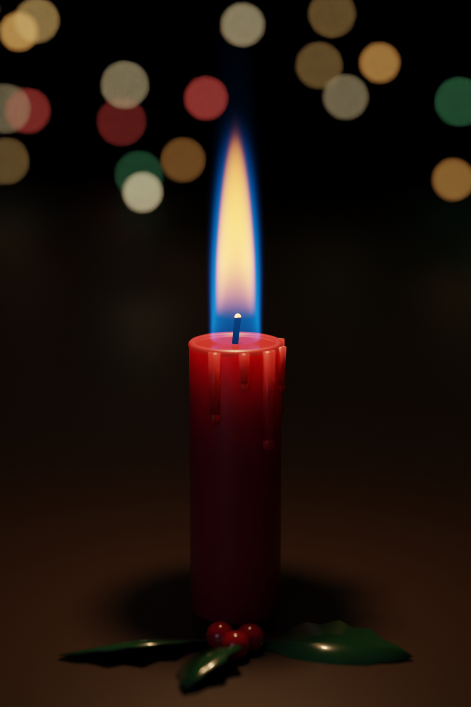
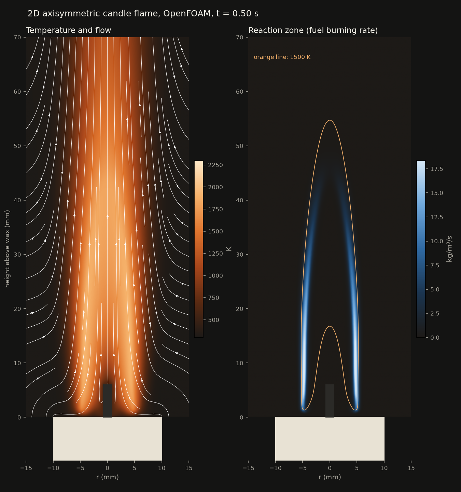

# OpenFOAM candle flame

A laminar candle flame simulated with **OpenFOAM v2412**, checked against **Cantera**, and rendered physically in **Blender Cycles**. The yellow glow comes from blackbody light at the simulated temperatures. The blue comes from CH\* and C₂\* chemiluminescence in the simulated reaction zone.

<p align="center">
  
  
</p>

▶ **Video:** [media/candle_physics.mp4](media/candle_physics.mp4) shows the candle, then breaks it down into soot glow, blue chemiluminescence, reaction zone, temperature and flow.

## What is simulated

| | |
|---|---|
| Solver | `rhoReactingBuoyantFoam`: laminar, compressible, buoyant, reacting |
| Geometry | 2D axisymmetric wedge: wick Ø 1.5 mm × 6 mm, candle Ø 20 mm, domain 40 mm × 120 mm, 14 k cells |
| Fuel | wax vapour modelled as n-dodecane, released from the wick at 0.1 g/min (a typical household candle) |
| Chemistry | Westbrook–Dryer 2-step (C₁₂H₂₆ → CO → CO₂), with the rate tuned against the detailed `nDodecane_Reitz` mechanism (100 species) in Cantera |
| Thermo / transport | NASA polynomials and Sutherland viscosity fits generated from Cantera species data |
| Radiation | P1 with grey-gas CO₂/H₂O absorption |
| Ignition | a 1500 K zone held around the wick tip for the first 40 ms |

**Results** (steady from about 0.3 s): flame tip 44 mm above the wax, peak gas temperature 1923 K, heat release about 73 W. The 2-step chemistry gives a stoichiometric flame speed of 0.78 m/s (detailed mechanism: 0.93 m/s; n-dodecane/air at 470 K).

## Honest caveats

- **No soot model.** The yellow luminous zone in the renders uses a *soot proxy*: hot, fuel-rich gas that contains CO. Without soot radiating heat away, the peak temperature (≈1920 K) is higher than in real candles (≈1670 K).
- **The wick is a fixed fuel-vapour source.** Wax melting, capillary rise and evaporation are not simulated.
- **2-step chemistry** captures flame shape and temperature well, but not intermediate species or soot precursors.
- **The flicker in the video is not simulated.** The axisymmetric flame is steady (real candles nearly are in still air). The Blender animation sways and stretches the steady flame to stand in for a gentle draft.
- **Flame height is on the tall side.** Roper's correlation for this fuel rate predicts about 28 mm; real candles are typically 30–50 mm.

## Run it

Linux or WSL2, with conda/mamba:

```bash
conda env create -f environment.yml
conda activate candle
NP=8 ./Allrun          # OpenFOAM run + plots + Blender renders + GIF/MP4
```

`Allrun` options: `NP` (cores, default 2), `END_TIME=0.05` (quick test), `SKIP_BLENDER=1`, `CANDLE_GPU=1` (Cycles on an NVIDIA GPU via OptiX/CUDA).

**Blender** needs either the `bpy` module on Python 3.13 (`python3.13 -m pip install bpy==5.2.2`, set `BPY_PYTHON` if it isn't `python3.13`), or the Blender 5.2 app (`BLENDER=/path/to/blender`).

On 2 CPU cores the 0.5 s OpenFOAM run takes about 25 min. A full-resolution Cycles still takes about 20 min on 2 CPU cores, and much less on a GPU.

<details>
<summary>Step by step</summary>

```bash
source etc/env.sh                         # OpenFOAM paths for the conda-forge build (+ fixes parallel Pstream)
python gen.py case                        # writes the case (mesh, thermo, chemistry, BCs)
cd case && cp -r 0.orig 0
blockMesh && topoSet && setFields
decomposePar && mpirun -np 8 rhoReactingBuoyantFoam -parallel && reconstructPar
postProcess -func writeCellCentres -time 0 && cd ..

python post.py case out                   # temperature / reaction-zone figure, ignition GIF, key numbers
python render.py case out                 # 2D line-of-sight render (no Blender)
python export_fields.py case fields       # emission maps for Blender
python gif_panels.py case gif             # physics breakdown panels
python3.13 blender_scene.py beauty 1080 1620 64 blend/candle_blender.png
python calib/calib.py det                 # detailed-mechanism flame speeds (Cantera)
python calib/calib.py 2s 9.6e11           # 2-step flame speeds with the tuned rate
```
</details>

## Files

| File | Purpose |
|---|---|
| `gen.py` | generates the complete OpenFOAM case from Cantera data |
| `calib/` | Cantera 1D flames: detailed mechanism vs 2-step calibration |
| `post.py`, `render.py` | result figures, ignition animation, 2D physical render |
| `export_fields.py`, `blender_scene.py` | emission maps → Blender volume (soot blackbody + chemiluminescence) |
| `gif_panels.py`, `make_gif.py` | physics panels and the GIF/MP4 |
| `etc/env.sh` | environment for conda-forge OpenFOAM |
| `data/radiationProperties.SandiaD_LTS` | grey-gas coefficients from the OpenFOAM tutorial |

## Versions

OpenFOAM v2412 (openfoam.com, conda-forge) · Cantera 3.2.0 · Blender 5.2.2 LTS (Cycles) · Python 3.12 (NumPy, SciPy, Matplotlib, Pillow) · ffmpeg

## References

- C. K. Westbrook, F. L. Dryer, *Simplified reaction mechanisms for the oxidation of hydrocarbon fuels in flames*, Combust. Sci. Technol. 27 (1981) 31–43.
- Cantera's bundled `nDodecane_Reitz.yaml` mechanism (detailed reference for calibration).
- F. G. Roper, *The prediction of laminar jet diffusion flame sizes: Part I. Theoretical model*, Combust. Flame 29 (1977) 219–226.
- Radiation coefficients: OpenFOAM `combustion/reactingFoam/RAS/SandiaD_LTS` tutorial.

## License

GPL-3.0, see [LICENSE](LICENSE). OpenFOAM and Blender's Python API are GPL. `data/radiationProperties.SandiaD_LTS` is copied from the OpenFOAM tutorials. Cantera is BSD-licensed.
